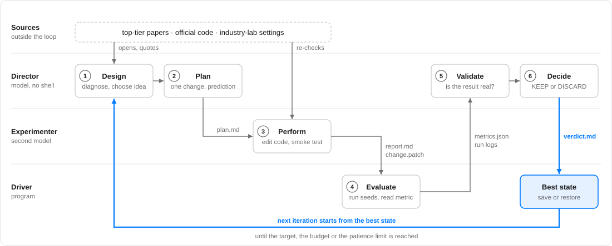
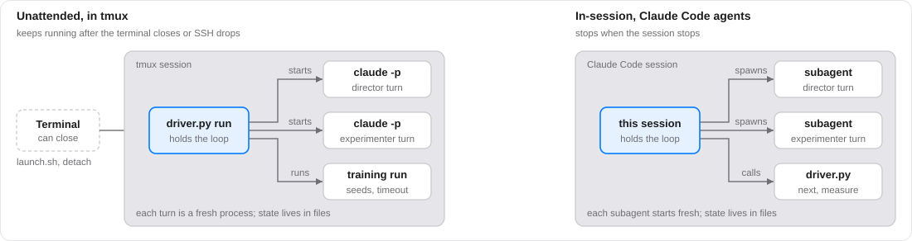

<div align="center">

## experiment-loop: an unattended, literature-grounded experiment loop for Claude Code

[](https://www.python.org/)


</div>

A Claude Code skill that keeps ML experiments running while you are away: design, plan, perform, evaluate, validate, decide, repeat.

- **Three parts.** A driver program measures every change and keeps the best-validation state. A director model picks ideas and judges results. A second model implements.
- **No guessed settings.** Every idea cites a top-tier conference (main track) or journal paper, its official code, or an industry lab's setting, opened and quoted that turn. No source, no run.
- **No noise wins.** A change is kept only if it beats the best by more than `min_delta`, set from the measured seed noise. The loop does not start without it.
- **Two modes.** `search` improves a setting step by step; `matrix` runs a fixed, pre-registered rows x seeds table with retries, holds and one results table, so results cannot steer it.
- **Escalation, not silence.** Decisions only the researcher can make go to an inbox and a notification command; only the affected item waits.
- **No git.** Nothing is committed or pushed. Prompts, including the code agents read, go to the model API.

<p align="center">
  
</p>
<div align="center">
  One iteration. The parts exchange only files, so every turn starts fresh and the loop survives restarts.
</div>

## Status

- **Driver self-test:** 8 of 8 scenarios pass (keep, discard, crash, timeout, abort, frozen-file violation, restart, in-session).
- **One full real run:** Fable 5.2 directing, Opus 5.5 implementing, 3 iterations. Kept 2 sourced changes, discarded 1 inside the noise, evaluation files untouched.
- **Not yet tested:** tmux path of `launch.sh` (ran via `screen` on macOS), Linux, the final-report turn, a completed in-session run.

## Installation

```shell
git clone https://github.com/Moon-Terry/experiment-loop.git ~/.claude/skills/experiment-loop
python3 ~/.claude/skills/experiment-loop/scripts/selftest.py   # < 1 min, no model or GPU
```

- **Needs:** bash, Python 3.8+, logged-in `claude` CLI, web access. tmux recommended (falls back to `screen` or `nohup`).
- **Update:** `git pull` in the skill folder, but not while a loop is running.

## Usage

In a Claude Code session inside your project:

```
Use experiment-loop to raise the validation accuracy of train.py. Only train.py and the
config may change. Run unattended; stop after 20 iterations or 24 hours.
```

- **Setup (with you):** the skill writes `.autoresearch/<name>/experiment.json`, measures the baseline and its noise, and collects sourced ideas while you can still veto them.
- **Your training script must:** print the validation metric, read its seed from `AR_SEED`, and train for a fixed budget.
- **Before leaving:** run `driver.py doctor` to confirm the agents answer unattended.

```shell
python3 ~/.claude/skills/experiment-loop/scripts/driver.py doctor .autoresearch/<name>
bash ~/.claude/skills/experiment-loop/scripts/launch.sh .autoresearch/<name>
```

<p align="center">
  
</p>
<div align="center">
  In tmux the loop survives a closed terminal. In-session it stops when the session stops.
</div>

- **Models:** Opus 5.5 at `medium` implements, Fable 5.2 at `high` directs (Anthropic's recommended starting points). Change them in `experiment.json`.
- **Warning:** the experimenter runs shell commands without confirmation. Use a machine and project where that is acceptable.

## While it runs

| Need | How |
| --- | --- |
| Progress | `driver.py status .autoresearch/<name>` or `tmux attach -t ar-<name>` |
| Stop cleanly | `touch .autoresearch/<name>/STOP` |
| Resume / run longer | raise the budget, run `launch.sh` again |

Results stay in `.autoresearch/<name>/`:

- `REPORT.md`: final report, outcome first
- `results.tsv`: one row per iteration with metric, decision, source
- `runs/NNN/`: plan, diff, logs, verdict
- `best/`: code and checkpoint of the best validation result

## Files

- `SKILL.md`: entry point
- `AGENTS.md`: working rules for every agent
- `references/`: grounding rules, role instructions, `experiment.json` fields (`spec.md`)
- `scripts/`: `driver.py` (the loop), `launch.sh`, `selftest.py`
- `evals/`: three test cases

## Acknowledgments

- Loop design follows [karpathy/autoresearch](https://github.com/karpathy/autoresearch).
- Part 1 of `AGENTS.md` is adapted from [karpathy-guidelines](https://github.com/multica-ai/andrej-karpathy-skills) by forrestchang (MIT License).
- The reporting rules in part 2 of `AGENTS.md` were inspired by the attention-kind style of [attention-span](https://github.com/alexgreensh/attention-span); the text is our own.
