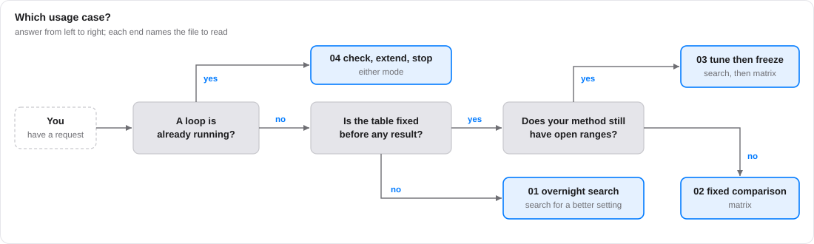

# Usage cases

Worked examples of what to type and what comes back. Pick the case closest to your situation.

  

| Situation | Mode | File |
| --- | --- | --- |
| One model, one validation metric, a night of idle GPU | `search` | [01-overnight-recipe-search.md](01-overnight-recipe-search.md) |
| A comparison table decided before any result (methods x seeds) | `matrix` | [02-fixed-comparison-table.md](02-fixed-comparison-table.md) |
| Your own method has ranges no paper can cite, and the final table must not see them move | `search`, then `matrix` | [03-tune-then-freeze.md](03-tune-then-freeze.md) |
| You are back and want the state, or more time | either | [04-check-extend-stop.md](04-check-extend-stop.md) |

Each file has the same parts: when to use it, the prompt, the key `experiment.json` fields, what you get, and the mistakes worth avoiding.
